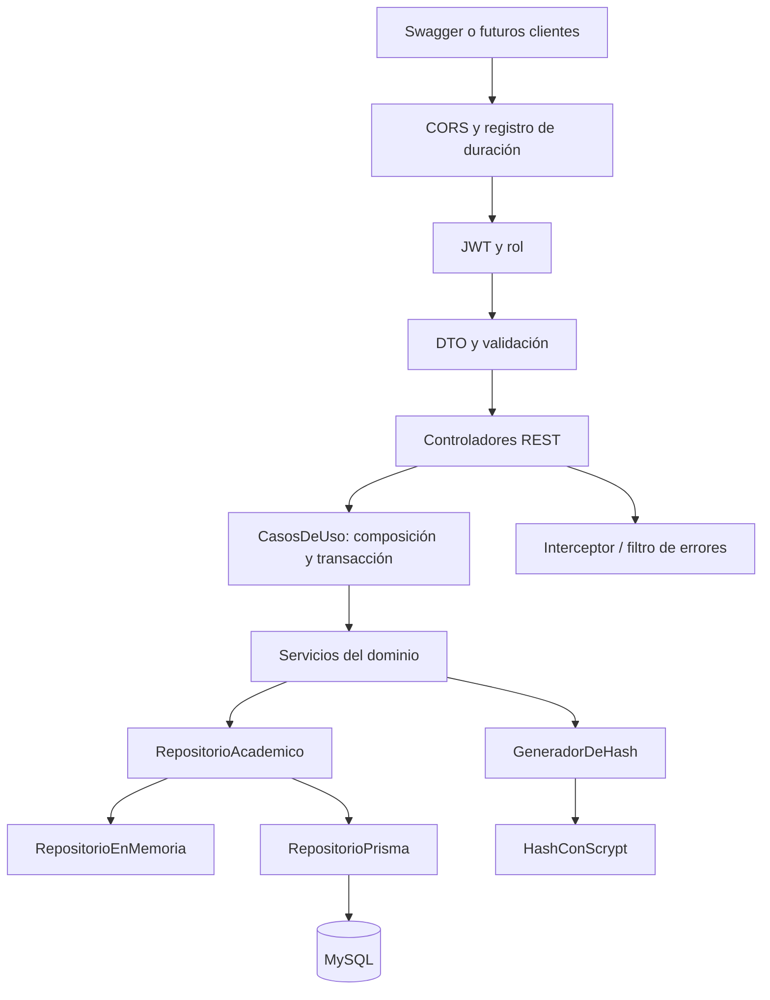
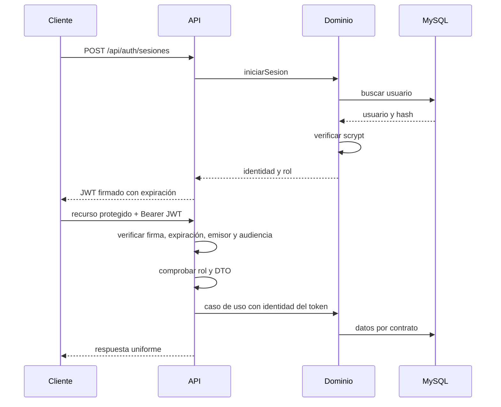

# Arquitectura

NestJS atiende HTTP. Los servicios del dominio no importan NestJS, Prisma ni Request/Response; conservan RepositorioAcademico.

## Composición y transacciones

CasosDeUso.ejecutar crea los servicios con RepositorioPrisma. Cambiar esa composición no obliga a reescribir las reglas de ServicioAlumno o ServicioMaestro. demo mantiene la composición en memoria. Las consultas adicionales de catálogo no modifican el contrato de dominio.

Todas las escrituras de API ejecutan una transacción y bloquean primero la fila Mutex id 1 con SELECT FOR UPDATE. READ COMMITTED permite que una operación en espera vea lo confirmado por la anterior. Validación y escritura permanecen juntas: el último cupo no se asigna dos veces, persona y cuenta se crean juntas y un lote de calificaciones se guarda completo o se revierte.

Esta solución sencilla serializa escrituras y puede limitar el rendimiento a gran escala. El bloqueo está en MySQL y funciona entre procesos. Las escrituras manuales desde Workbench no pasan por esta composición.

## Autorregistro futuro

ServicioRegistro contiene validaciones y creación de alumnos/maestros, sin depender de una sesión administrativa. Hoy ServicioAdministracion verifica al actor y delega; POST /alumnos y POST /maestros exigen rol administrador.

Para autorregistro posterior, agrega un caso de uso/controlador de alumnos con la política de admisión correspondiente y reutiliza ServicioRegistro.registrarAlumno. No necesita fabricar una sesión administrativa ni copiar validaciones. El rol lo asigna el servidor, no el cliente. Hoy no existe ese endpoint público, ni autorregistro de maestros o administradores.

## Identidad

Sin token o con token inválido: 401. Rol insuficiente: 403. Regla de negocio: 409. Recurso inexistente: 404. Petición mal formada: 400.
