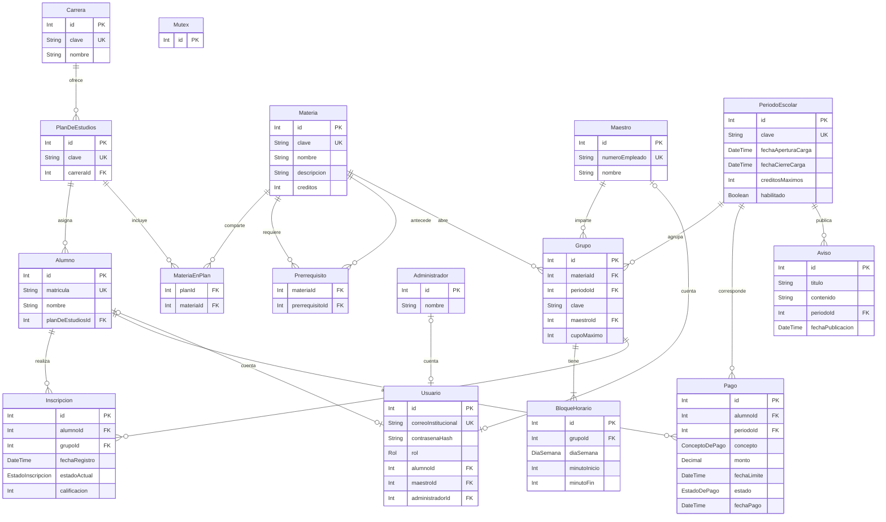

# Modelo de datos

MySQL almacena el catálogo, las personas y las operaciones académicas. Los atributos coinciden con schema.prisma y las dos migraciones SQL.

## Atributos

| Entidad | Atributos (tipo del esquema; ? indica opcional) |
|---|---|
| Carrera | id (Int), clave (String), nombre (String) |
| PlanDeEstudios | id (Int), clave (String), carreraId (Int) |
| Materia | id (Int), clave (String), nombre (String), descripcion (String), creditos (Int) |
| MateriaEnPlan | planId (Int), materiaId (Int) |
| Prerrequisito | materiaId (Int), prerrequisitoId (Int) |
| Alumno | id (Int), matricula (String), nombre (String), planDeEstudiosId (Int) |
| Maestro | id (Int), numeroEmpleado (String), nombre (String) |
| Administrador | id (Int), nombre (String) |
| PeriodoEscolar | id (Int), clave (String), fechaAperturaCarga (DateTime), fechaCierreCarga (DateTime), creditosMaximos (Int), habilitado (Boolean) |
| Grupo | id (Int), materiaId (Int), periodoId (Int), clave (String), maestroId (Int), cupoMaximo (Int) |
| BloqueHorario | id (Int), grupoId (Int), diaSemana (DiaSemana), minutoInicio (Int), minutoFin (Int) |
| Inscripcion | id (Int), alumnoId (Int), grupoId (Int), fechaRegistro (DateTime), estadoActual (EstadoInscripcion), calificacion (Int?) |
| Pago | id (Int), alumnoId (Int), periodoId (Int), concepto (ConceptoDePago), monto (Decimal), fechaLimite (DateTime), estado (EstadoDePago), fechaPago (DateTime?) |
| Aviso | id (Int), titulo (String), contenido (String), periodoId (Int), fechaPublicacion (DateTime) |
| Usuario | id (Int), correoInstitucional (String), contrasenaHash (String), rol (Rol), alumnoId (Int?), maestroId (Int?), administradorId (Int?) |
| Mutex | id (Int) |

_migraciones es una tabla técnica adicional del ejecutor: nombre (PK), checksum SHA-256, estado, iniciadoEn y aplicadoEn opcional. Mutex es técnico: su fila id 1 coordina las transacciones de escritura.

## Relaciones y restricciones

- Carrera tiene muchos planes; un alumno pertenece a un plan.
- Plan y Materia se relacionan muchos a muchos mediante MateriaEnPlan. Una materia puede ser compartida.
- Prerrequisito relaciona la materia objetivo con las materias que deben aprobarse antes.
- Un Grupo pertenece a una materia, un período y un maestro, y tiene uno o más bloques de horario.
- Inscripcion une Alumno y Grupo; almacena fecha, estado y calificación opcional. Puede haber registros históricos de bajas; la duplicidad de materia activa en el período se controla en el dominio dentro de la transacción.
- Pago pertenece a un alumno y período; monto usa DECIMAL(12,2), estado y fecha de pago reflejan su liquidación.
- Aviso pertenece a un período.
- Usuario tiene exactamente una relación con Alumno, Maestro o Administrador según su rol, garantizada por CHECK. Las relaciones son únicas, por lo que cada persona tiene como máximo una cuenta.
- El contrato de dominio conserva personaId; RepositorioPrisma lo traduce a las claves foráneas de Usuario.

Rol: alumno, maestro, administrador. EstadoInscripcion: activa, baja. ConceptoDePago: inscripcion, colegiatura. EstadoDePago: pendiente, pagado. DiaSemana: lunes a sábado.

El mínimo de un bloque por grupo se valida en el dominio; las claves foráneas por sí solas no imponen ese mínimo. Horarios, cupo, seriación, créditos y pagos se validan con las reglas del dominio antes de guardar.
